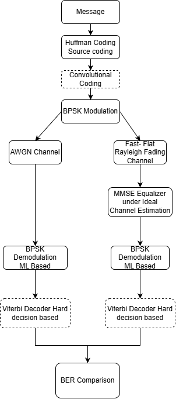
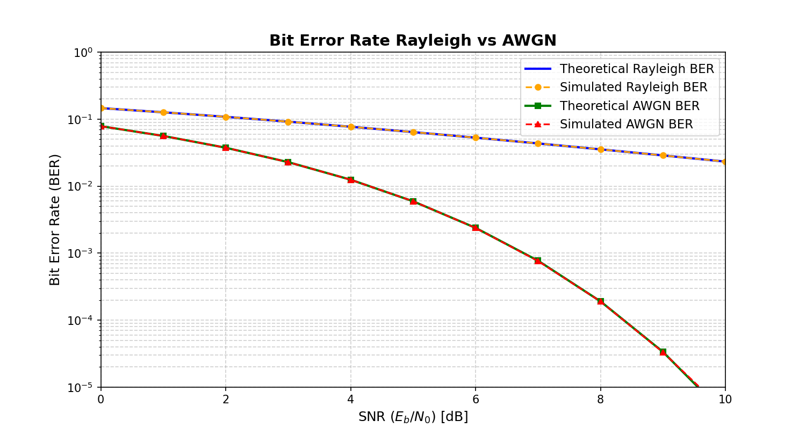

# Digital Communication Link Simulator: AWGN vs Rayleigh Fading

A Python-based baseband physical layer (PHY) simulator. This project models an end-to-end BPSK communication link to analyze and compare Bit Error Rate (BER) performance across AWGN and Fast Flat Rayleigh fading channels. 

## Key Features
* **Core DSP Implementation:** Modulators, channel models, and equalizers are mathematically derived and coded using fundamental Python libraries (NumPy/SciPy).
* **Fading vs Non-Fading Analysis:** Direct performance comparison between Additive White Gaussian Noise (AWGN) and multipath Rayleigh environments.
* **MMSE Equalization:** Handles phase and amplitude distortions introduced by the fading channel.
* **Theoretical Validation:** Simulated BER curves are strictly verified against theoretical bounds.

## 1. System Architecture

*Note:Convolutional coding and Viterbi decoding is bypassed in this specific BER comparison to purely isolate the channel effects. These blocks are represented by dotted lines in the flowchart, though their implementation exists in the repository.*

## 2. Mathematical Formulation

* **AWGN Channel:** The additive noise is modeled as a complex Gaussian random variable. Noise in both In-phase (I) and Quadrature (Q) components follows a Normal distribution $\mathcal{N}(0, \sigma^2 = N_0/(2 \Delta t))$.
* **Fast Flat Rayleigh Fading:** Channel coefficients ($h$) are generated in polar form. The amplitude follows a Rayleigh distribution $2a e^{-a^2}$ (normalized to unit power, $\sigma^2 = 1/2$, ensuring $E[|h|^2] = 1$). The phase follows a uniform distribution over $[-\pi, \pi]$.
* **MMSE Equalizer:** The receiver currently assumes ideal channel estimation. The exact $h$ generated during the channel pass is reused at the receiver to calculate the Minimum Mean Square Error weights: $w = h^* / (|h|^2 + N_0)$.

## 3. BER Performance Evaluation

The simulation results are benchmarked against the following exact theoretical expressions:
* **BPSK in AWGN:** 
  $$P_b = \frac{1}{2} \text{erfc}\left(\sqrt{\frac{E_b}{N_0}}\right)$$
* **BPSK in Rayleigh Fading:** 
  $$P_b = \frac{1}{2} \left(1 - \sqrt{\frac{E_b/N_0}{1 + E_b/N_0}}\right)$$

## 4. Repository Structure 
* `Main.py` / `Simulation.py` — Main execution scripts for generating the BER curves.
* `AWGN_Channel.py` & `Rayleigh.py` — Custom channel matrices and noise generation.
* `BPSK_Modulator.py` & `Demodulator_BPSK.py` — Baseband symbol mapping and ML-based detection.
* `Equalizer.py` — MMSE equalization logic.
* *(Archive)* `Convolutional_Coding.py`, `Viterbi_Decoder.py`, `Source_Coding.py` — Earlier phase modules for Huffman and channel coding.

## 5. Future Plans
* Practical Channel Estimation: Replace the ideal channel estimation assumption with pilot-symbol insertion and estimation (e.g., Least Squares).
* Antenna Diversity: Implement multiple receive antennas (SIMO/Maximum Ratio Combining) to observe diversity gains against deep fades.
